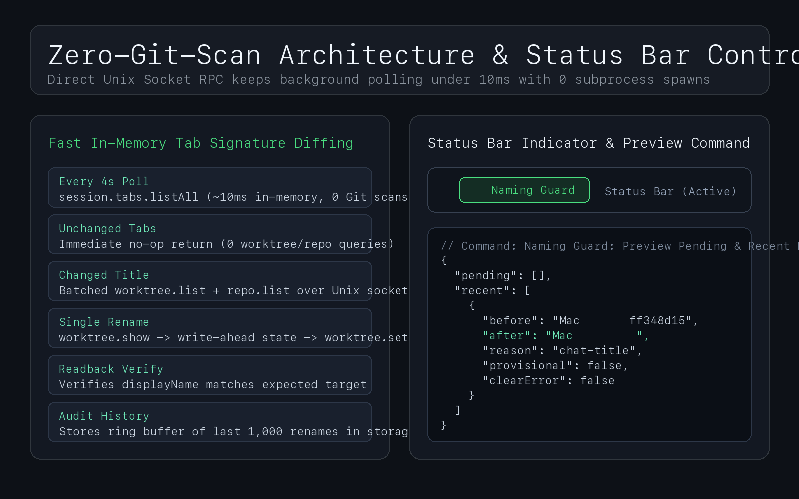

# Workspace Naming Guard (`workspace-naming-guard`)

**Zero-latency `Project｜Topic` workspace & Git worktree auto-namer for [Orca](https://onorca.dev/).**


---

## Why Workspace Naming Guard?

When running dozens or hundreds of parallel coding agents across multiple repositories in Orca, sidebar hygiene quickly breaks down:
1. **Random animal slugs**: Newly created folder workspaces and Git worktrees start with random names like `blobfish`, `seagrass`, or `codex/mojarra`.
2. **Disconnected chat & worktree names**: Orca names agent chat tabs and worktree branches independently, often leaving worktrees stuck on generic slugs or failing when background CLI branch-renaming hits rate/usage limits (`firstAgentMessageRenameError`).
3. **Subprocess Git-scan lag**: Naive polling scripts that shell out to `orca worktree list` trigger full Git status scans across every worktree on disk, causing multi-second UI stalls.

**Workspace Naming Guard** solves all three problems in a lightweight, zero-token `trusted-worker` plugin:
- **Stage 1 — Standby Assignment on Creation**: Listens to `workspace.created` and immediately assigns a deterministic standby display name (`<Project>｜待命工作区 <8-char hash>`) while clearing `pendingFirstAgentMessageRenameError`.
- **Stage 2 — Provisional First-Prompt Seed**: Even before an agent finishes summarizing a conversation (or if CLI summarization fails due to quota limits), extracts a clean provisional topic (`<= 24` chars) directly from the user's first prompt in the local session journal.
- **Stage 3 — Canonical Agent Summary & Manual Edit Guard**: Once the agent chat tab settles on a formal title, upgrades the workspace display name to `<Project>｜<Topic>`, normalizes CJK/ASCII spacing, enforces canonical project prefixes, and permanently yields if you ever rename the workspace manually.

---

## Architecture & Performance




- **Sub-10ms In-Memory Diffing**: Every 4 seconds, the worker calls `session.tabs.listAll` directly over Orca's local Unix domain socket (~10ms in-memory, **0 Git subprocess scans**).
- **On-Demand Reconciliation**: Full `worktree.list` + `repo.list` RPC batching only runs when an `agent-session` tab title or prompt actually changes, or when `workspace.created` fires.
- **Write-Ahead Crash Safety**: Before calling `worktree.set` (<1ms), the plugin records write-ahead intent in `orca.storage` (`state-v1`), verifies readback after mutation, and maintains a 1,000-entry ring buffer of rename history.
- **Zero LLM / Cloud Calls**: Pure deterministic string normalization and local IPC. Never invokes an LLM, never consumes API tokens, never touches Git branches or filesystem directories, and never makes network requests.

---

## Installation

### From the Orca Community Marketplace
1. Open **Orca → Settings → Plugins**.
2. Ensure the community catalog (`https://github.com/stablyai/orca-community-plugins.git`, ref `main`) is added.
3. Search for **Workspace Naming Guard** (`rem021.workspace-naming-guard`) and click **Install**.

### From GitHub or CLI
```bash
orca plugin install https://github.com/Rem021/workspace-naming-guard.git
```

### Local Development
```bash
git clone https://github.com/Rem021/workspace-naming-guard.git
cd workspace-naming-guard
node --test *.test.mjs
orca plugin validate . --json
orca plugin dev load .
```

---

## Configuration (Environment Variables)

You can customize path boundaries and project prefix aliases via environment variables:

| Variable | Default | Description |
| :--- | :--- | :--- |
| `PROJECT_ALIASES_JSON` | Built-in map | JSON object mapping raw repository `displayName` values to canonical project prefixes (e.g. `'{"MyRepo":"CoreApp"}'`). |
| `AI_VOLUME_PATH` | `/Volumes/AI_Workspace` | Optional external volume root to include alongside `$HOME` in managed workspace path checks. |
| `AI_VOLUME_UUID` | `AUTO` | Optional macOS volume UUID (`diskutil info -plist`) safety check before mutating workspaces on an external drive. |
| `ORCA_NAMING_READ_ONLY` | `0` | Set to `1` to run reconciliation in dry-run preview mode without mutating workspace names. |

---

## Commands & Status Bar

- **Status Bar Indicator (`✎ Naming Guard`)**: Shows real-time health in the Orca status bar. Clicking it runs `naming.preview`.
- **Command Palette (`Naming Guard: Preview Pending & Recent Renames`)**: Returns `{ pending, recent }` with any queued renames and the last 10 applied rename records.

---

##中文说明（Chinese Overview）

**Workspace Naming Guard** 是一款专为 Orca 打造的高性能工作区与 Git Worktree 自动命名插件：
1. **新建即刻归位**：监听 `workspace.created` 事件，将新建工作区的随机鱼名（如 `blobfish`、`seagrass`）规范化为 `项目名｜待命工作区 <短哈希>`，并自动清理 `firstAgentMessageRenameError` 报错残留。
2. **首条指令兜底提炼 + 标题自动升级**：当向智能体发送任务后，即使模型尚未生成会话摘要（或因 CLI 额度限制未能生成标题），也能从本地会话日志首条指令自动提炼暂定标题；待正式摘要生成后自动升级为 `项目名｜具体主题`。
3. **零 Git 扫描开销**：通过直连本机 Orca Unix Socket RPC，每 4 秒仅做内存态 `session.tabs.listAll` 签名比对（耗时 ~10ms，0 次 Git 扫描），单工作区改名 <1ms。
4. **尊重人工改名**：具备预写日志（Write-Ahead Intent）与读回校验；一旦检测到用户手动修改了已命名的工作区名称，插件永久停止接管该工作区。

---

## License

[MIT](LICENSE) © [Rem021](https://github.com/Rem021)
