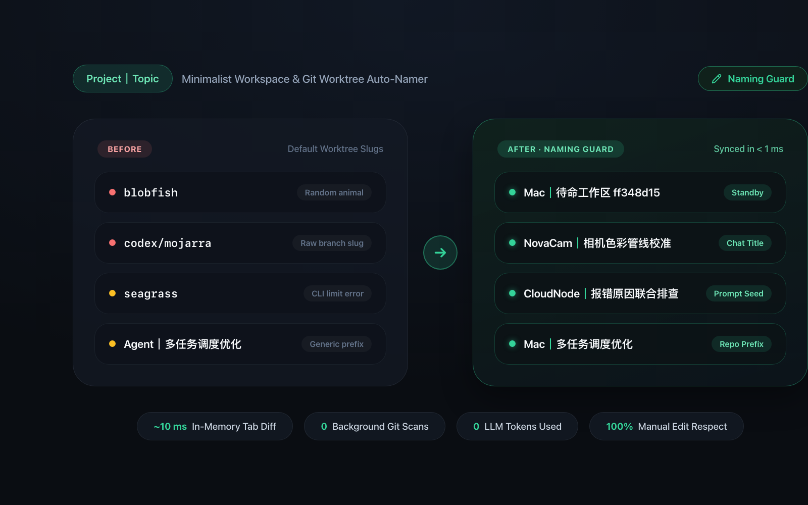
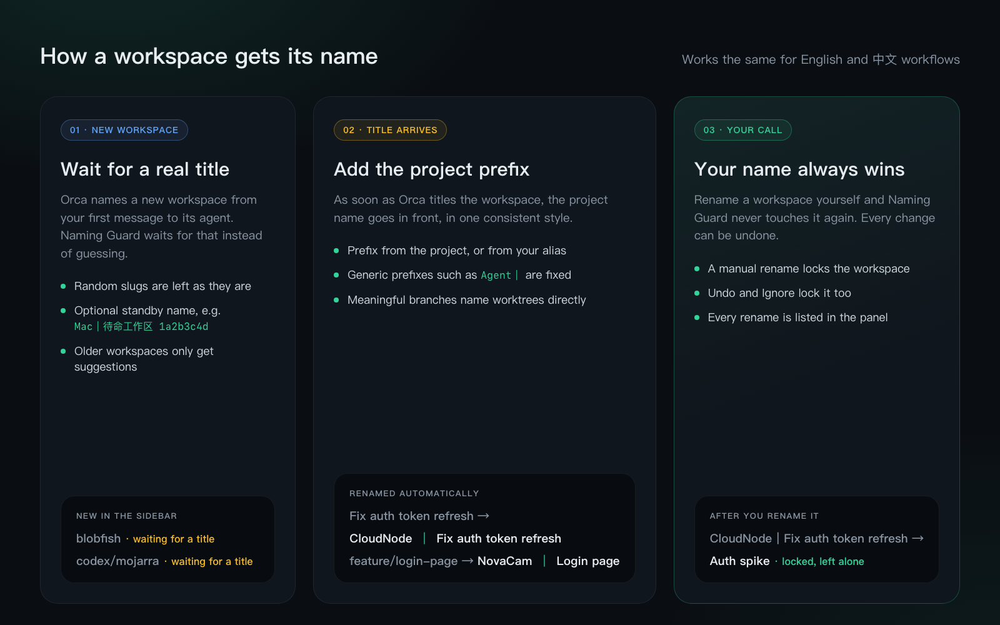
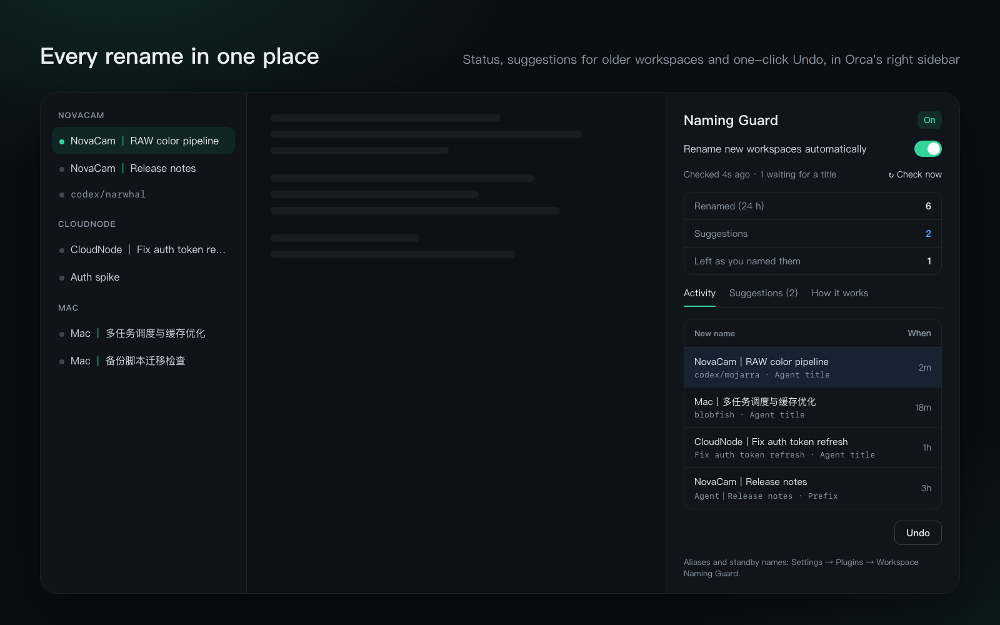

# Workspace Naming Guard

**Automatically name Orca workspaces `Project｜Topic`, including native chat titles with the optional CLI connector.**

Turn `Fix auth token refresh` into `CloudNode｜Fix auth token refresh`, so you can find the right workspace at a glance. Includes rename history, suggestions, and Undo.

[中文说明](#中文说明) · **[Install](#install)** · [How it works](#how-it-works) · [Settings](#settings)

[](https://github.com/Rem021/workspace-naming-guard/releases) [](LICENSE)

## Install

Requires **Orca 1.4.256 or later**.

- **From Orca:** Settings → Plugins → search for *Workspace Naming Guard* (community catalog) → Install.
- **From Git:** `orca plugin install https://github.com/Rem021/workspace-naming-guard.git`



## Before and after

When you run many agents across many repositories, the sidebar fills up with `blobfish`, `codex/mojarra` and titles that don't say which project they belong to. Naming Guard watches new workspaces and gives each one a name you can scan at a glance:

| What Orca shows | After Naming Guard | Why |
| :-- | :-- | :-- |
| `Fix auth token refresh` | `CloudNode｜Fix auth token refresh` | Orca's agent title, with the project prefix added |
| `多任务调度与缓存优化` | `Mac｜多任务调度与缓存优化` | Works the same for Chinese titles |
| `feature/login-page` | `NovaCam｜Login page` | A worktree whose branch already says what it is for |
| `Agent｜Release notes` | `NovaCam｜Release notes` | A generic or wrong prefix is replaced |

## How it works



1. **A new workspace waits for a meaningful title.** With the optional connector below, it can use the exact workspace’s native chat title, even if Orca leaves the sidebar on a random animal name. Naming Guard adds the project prefix when Orca supplies a workspace title. It does not write a standby name merely because time passed. Turn on *standby names* if you would rather see `Project｜待命工作区 1a2b3c4d` right away (this replaces Orca's own AI title for that workspace).
2. **The title gets the project prefix.** The prefix is the project's name, or the alias you set. Generic prefixes such as `Agent｜`, an alias, or another project's name are replaced. A deliberate prefix of your own is kept word for word.
3. **A provisional name can improve.** Plugin-owned branch and standby names can become chat topics. Once a chat supplies the topic, only that same chat can refine it; switching tabs or a second agent cannot take over.
4. **Your rename is final.** If you rename a workspace yourself after Naming Guard did, it is locked and never touched again. Undo and Ignore lock it too.

Naming Guard cannot tell Orca's title from a name you type when you create a workspace, so a typed name gets the prefix once too (rename it again, or press Undo, and it stays as you wrote it). Workspaces first seen while Naming Guard is on remain eligible until they receive a name, even when their first useful title arrives days later; while it is paused nothing is renamed and new workspaces become suggestions.

Workspaces that existed before you installed the plugin are **never renamed on their own**. Naming Guard lists them under *Suggestions* in its panel, and you apply the ones you want. Project checkouts (a worktree on `main`, `master`, `trunk`, `develop` or `dev`, or one with a Git branch in a folder named after the project) and a project's root folder are always skipped.

## The panel



Open **Naming Guard** from the right sidebar to:

- see whether it is on, when it last checked, and how many new workspaces are waiting for a title;
- pause or resume automatic renaming;
- review every rename and **Undo** any of them;
- apply or ignore **Suggestions** for older workspaces.

The status bar item shows the same state; click it for a one-line summary. Commands in the palette: *Naming Guard: Show Status*, *Check Names Now*, *Pause or Resume*.

## Settings

**Settings → Plugins → Workspace Naming Guard**

| Setting | Default | What it does |
| :-- | :-- | :-- |
| Rename new workspaces automatically | On | Off: only suggestions, nothing is renamed on its own. |
| Project prefix aliases | empty | One per line, `Project name = Prefix`, e.g. `my-api-v2 = API`. Lines starting with `#` are ignored; bad lines are shown in the panel. |
| Give new workspaces a standby name right away | Off | Names a new workspace `Prefix｜<label> <8-char id>` as soon as it is created. |
| Standby label | `待命工作区` | The word used in standby names, e.g. `待命工作区`. |

## Privacy and access

Naming Guard is a `trusted-worker` plugin that uses **only Orca's plugin API**, and its log never contains workspace names. It asks for:

- `workspace:read`: list workspaces (`workspace.list`) and hear when one is created;
- `workspace:write`: rename them (`workspace.rename`), the same as renaming by hand;
- `storage:own` and `settings:own`: its own rename history and your settings.

It does not read Orca's files or databases, start other programs, use the network, call an LLM or touch Git branches and folders. Every rename is recorded in Orca's plugin audit log.

## Develop

```bash
git clone https://github.com/Rem021/workspace-naming-guard.git
cd workspace-naming-guard
orca plugin types .        # writes .orca/types for editor completion
orca plugin test . --json  # core rules, worker and panel tests
PYTHONDONTWRITEBYTECODE=1 python3 -m unittest discover -s tests -q
orca plugin check . --json # renders the panel in each src/panel.check.ts scenario
orca plugin dev watch .    # loads it into Orca and streams logs
```

- `src/core.ts`: the naming rules, pure functions with no I/O.
- `src/worker.ts`: lists, plans and renames; keeps history and a write-ahead record in plugin storage.
- `src/panel.tsx`: the sidebar panel (Orca components, English and Chinese).
- `assets/source/`: HTML sources of the store images, rendered at 1600×1000 (icon 512×512).

### Native chat title connector (Orca 1.4.261)

Orca’s plugin `workspace.list` exposes sidebar names, not native chat titles. Its `agents.list` can return a native session ID with a null title, and `agent.listSessions` can omit those chats entirely. Do not match session history by folder: many Orca workspaces can share one directory.

`scripts/title_bridge.py` reads the official `orca worktree ps` JSON and forwards **only workspace ID, chat title and pane ID** to `naming.observeTitles` through `orca plugin dev request`. It never reads private Orca files/databases, sends agent input, or changes Git. The CLI snapshot includes activity previews; the connector discards them and never forwards or logs them. Plugin code still imports only the official plugin API and relative modules; its four original permissions are unchanged. The connector is a separate, optional Python process, not secretly started by the plugin.

For the current **development-folder installation** (the CLI’s request surface is a development tool):

```bash
orca plugin dev load /absolute/path/to/workspace-naming-guard
# Review Orca's exact approval request if this folder has not been approved.
python3 scripts/title_bridge.py --orca /Applications/Orca.app/Contents/Resources/bin/orca
# macOS: explicitly install the connector to start at login and check every 30 seconds.
python3 scripts/title_bridge.py --orca /Applications/Orca.app/Contents/Resources/bin/orca --install
```

The default plugin key is `local.workspace-naming-guard`; `--plugin` selects a different key. Development folders owned by a different publisher need their actual key from `orca plugin list`. Marketplace installations retain workspace/branch naming; native chat synchronization is verified with the development-folder connector above.

The macOS installer copies only the connector to `~/Library/Application Support/Workspace Naming Guard/` and creates `~/Library/LaunchAgents/dev.rem021.workspace-naming-guard.title-bridge.plist`. It does not restart Orca. To stop it, run `launchctl bootout gui/$(id -u)/dev.rem021.workspace-naming-guard.title-bridge`, then move that plist to Trash to stop future login launches. `--watch` runs it in the foreground on other systems; without flags it checks once.

The panel reports whether the connector is connected. Observations expire after two minutes without a successful sync; workspace/branch naming keeps working. No chat title means no fabricated topic or default timed standby name. Multiple parent chats use the most recently active named parent on first naming, then keep that association; subagent titles and ambiguous workspace IDs are skipped. Existing unowned workspaces still appear as suggestions. Manual rename, Ignore and Undo take precedence. A final workspace-derived title is not replaced automatically; only plugin-owned branch, standby or same-chat titles can improve.

Version 1.1.1's timed standby fallback remains removed. The connector supplies actual titles instead of reintroducing that fallback.

---

## 中文说明

**Workspace Naming Guard（命名守卫）**把 Orca 的工作区名称统一成 `项目｜主题` 格式，并且永远尊重你手动起的名字。

- **修正 v1.1.1 回归**：已移除默认 60 秒超时补名，也不再读取旧的 `fallbackNames` 开关。没有可靠主题时继续等待；只有显式开启“立即待命命名”才会写入待命名称。聊天页签标题与工作区标题不同；v1.2.0 可通过上方官方 CLI 桥接器接入原生聊天标题。
- **新工作区自动命名**：Orca 根据你发给智能体的第一条消息给工作区起名后，命名守卫补上项目前缀，例如 `Fix auth token refresh` → `CloudNode｜Fix auth token refresh`；中文标题同样适用。分支名本身有意义的工作树（如 `feature/login-page`）直接按分支命名；文件夹会话的 `naming-guard-fix` 这类名称也会转换为主题。同目录、无 Git 分支的会话不再误判为项目主检出。
- **原生聊天标题**：可选的本机桥接器每 30 秒读取官方 CLI 的精确工作区/聊天关联，解决聊天已有标题、侧栏仍叫随机动物名的问题。同目录对话按独立 ID 区分；子智能体不抢名字。插件生成的分支名、待命名可以升级为聊天主题，同一聊天后续完善标题也会同步。原始工作区标题和手动命名不会被新聊天强行覆盖。桥接器离线超过两分钟后不再使用旧标题，面板会提示。
- **前缀修正**：`Agent｜…` 这类通用前缀、别名或其他项目的前缀会换成本项目前缀；你自己刻意写的前缀保持原样。
- **你的改名是最终的**：命名守卫命名过的工作区，你手动改名、点“撤销”或“忽略”之后不再被改动。创建时手填的名字会像 Orca 标题一样补一次前缀；插件开启期间新出现的工作区持续等待主题，不再因超过 6 小时而失去自动命名资格，暂停期间新工作区只进“建议”。
- **已有工作区只给建议**：安装前就存在的工作区不会被自动改名，在面板的“建议”页里由你决定是否应用。项目主检出（`main` 等分支上的工作树）和项目根文件夹一律跳过。
- **待命名称（可选）**：开启后，新工作区一创建就命名为 `项目｜<标签> 1a2b3c4d`（标签默认 `待命工作区`）；注意这会替代 Orca 自带的 AI 标题。
- **面板**：右侧边栏的“命名守卫”面板显示运行状态、重命名记录（可撤销）和建议；界面跟随 Orca 语言显示中文或英文。
- **设置**：设置 → 插件 → Workspace Naming Guard，可配置项目前缀别名（每行一条：`项目名 = 前缀`）、待命名称及其标签。
- **隐私**：只使用 Orca 官方插件 API（`workspace.list` / `workspace.rename`），不读取 Orca 的文件或数据库、不联网、不调用大模型。插件本身不运行其他程序；可选桥接器是单独的 Python 进程，只调用官方 `orca` CLI，并只向插件传工作区 ID、标题与聊天标识。

需要 Orca 1.4.256 或更高版本。

## License

[MIT](LICENSE) © [Rem021](https://github.com/Rem021)
