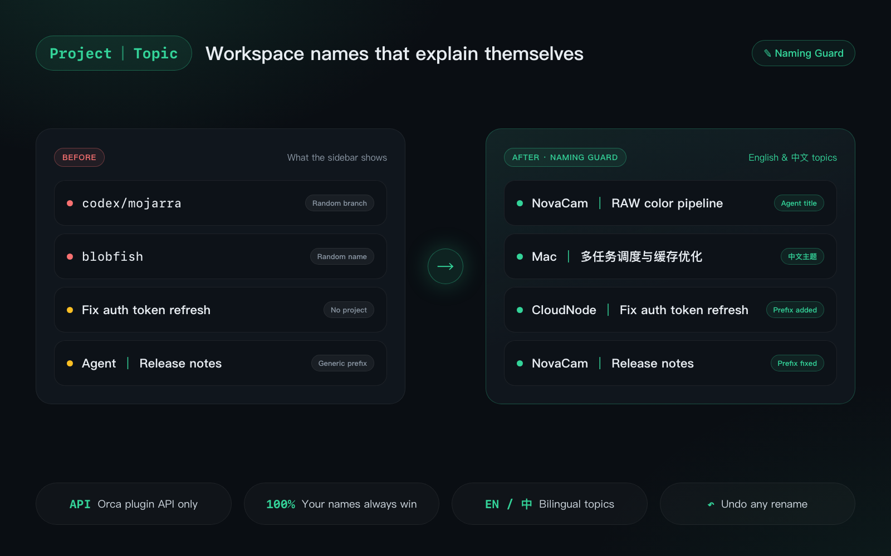
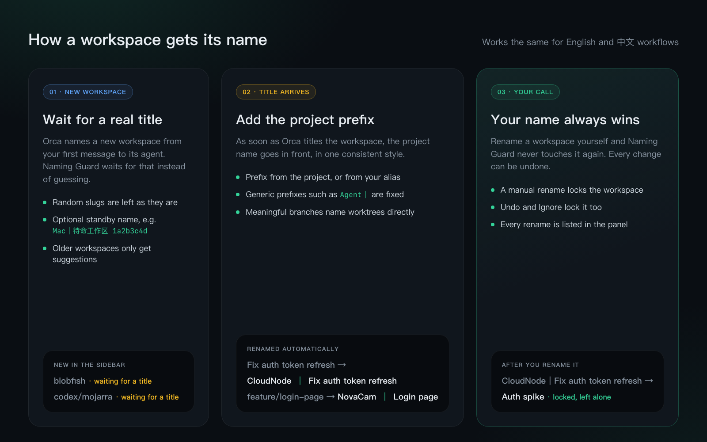
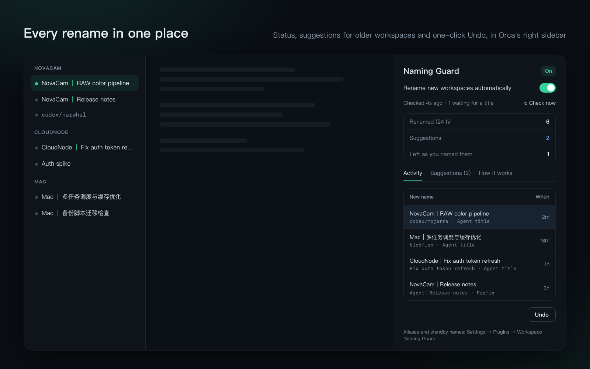

# Workspace Naming Guard

**Keeps [Orca](https://orca.dev/) workspace names in one tidy `Project｜Topic` form, and never overrides a name you chose yourself.**



When you run many agents across many repositories, the sidebar fills up with `blobfish`, `codex/mojarra` and titles that don't say which project they belong to. Naming Guard watches new workspaces and gives each one a name you can scan at a glance:

| What Orca shows | After Naming Guard | Why |
| :-- | :-- | :-- |
| `Fix auth token refresh` | `CloudNode｜Fix auth token refresh` | Orca's agent title, with the project prefix added |
| `多任务调度与缓存优化` | `Mac｜多任务调度与缓存优化` | Works the same for Chinese titles |
| `feature/login-page` | `NovaCam｜Login page` | A worktree whose branch already says what it is for |
| `Agent｜Release notes` | `NovaCam｜Release notes` | A generic or wrong prefix is replaced |

## How it works



1. **A new workspace waits for a real title.** Orca names a workspace from your first message to its agent. Naming Guard leaves random slugs alone until that title arrives. Turn on *standby names* if you would rather see `Project｜待命工作区 1a2b3c4d` right away (this replaces Orca's own AI title for that workspace).
2. **The title gets the project prefix.** The prefix is the project's name, or the alias you set. Generic prefixes such as `Agent｜`, an alias, or another project's name are replaced. A deliberate prefix of your own is kept word for word.
3. **Your name always wins.** If you rename a workspace yourself after Naming Guard did, it is locked and never touched again. Undo and Ignore lock it too.

Workspaces that existed before you installed the plugin are **never renamed on their own**. Naming Guard lists them under *Suggestions* in its panel, and you apply the ones you want. Project checkouts (a worktree on `main`, `master`, `trunk` or `develop`) and a project's root folder are always skipped.

## The panel



Open **Naming Guard** from the right sidebar to:

- see whether it is on, when it last checked, and how many new workspaces are waiting for a title;
- pause or resume automatic renaming;
- review every rename and **Undo** any of them;
- apply or ignore **Suggestions** for older workspaces.

The status bar item shows the same state; click it for a one-line summary. Commands in the palette: *Naming Guard: Show Status*, *Check Names Now*, *Pause or Resume*.

## Settings

**Settings → Plugins → Workspace Naming Guard**

| Setting | Default | What it does |
| :-- | :-- | :-- |
| Rename new workspaces automatically | On | Off: only suggestions, nothing is renamed on its own. |
| Project prefix aliases | empty | One per line, `Project name = Prefix`, e.g. `my-api-v2 = API`. Lines starting with `#` are ignored; bad lines are shown in the panel. |
| Give new workspaces a standby name right away | Off | Names a new workspace `Prefix｜<label> <8-char id>` as soon as it is created. |
| Standby label | `待命工作区` | The word used in standby names, e.g. `Standby`. |

## Privacy and access

Naming Guard is a `trusted-worker` plugin that uses **only Orca's plugin API**. It asks for:

- `workspace:read`: list workspaces (`workspace.list`) and hear when one is created;
- `workspace:write`: rename them (`workspace.rename`), the same as renaming by hand;
- `storage:own` and `settings:own`: its own rename history and your settings.

It does not read Orca's files or databases, start other programs, use the network, call an LLM or touch Git branches and folders. Every rename is recorded in Orca's plugin audit log.

## Install

Requires **Orca 1.4.256 or later**.

- **From Orca:** Settings → Plugins → search for *Workspace Naming Guard* (community catalog) → Install.
- **From Git:** `orca plugin install https://github.com/Rem021/workspace-naming-guard.git`

## Develop

```bash
git clone https://github.com/Rem021/workspace-naming-guard.git
cd workspace-naming-guard
orca plugin types .        # writes .orca/types for editor completion
orca plugin test . --json  # core rules, worker and panel tests
orca plugin check . --json # renders the panel in each src/panel.check.ts scenario
orca plugin dev watch .    # loads it into Orca and streams logs
```

- `src/core.ts`: the naming rules, pure functions with no I/O.
- `src/worker.ts`: lists, plans and renames; keeps history and a write-ahead record in plugin storage.
- `src/panel.tsx`: the sidebar panel (Orca components, English and Chinese).
- `assets/source/`: HTML sources of the store images, rendered at 1600×1000 (icon 512×512).

### Roadmap

Orca 1.4.259 adds `agent.listSessions` (host API 1.9). A later version will use it to name workspaces from agent chat titles as well, including Orca's native chat sessions and Chinese first prompts.

---

## 中文说明

**Workspace Naming Guard（命名守卫）**把 Orca 的工作区名称统一成 `项目｜主题` 格式，并且永远尊重你手动起的名字。

- **新工作区自动命名**：Orca 根据你发给智能体的第一条消息给工作区起名后，命名守卫补上项目前缀，例如 `Fix auth token refresh` → `CloudNode｜Fix auth token refresh`；中文标题同样适用。分支名本身有意义的工作树（如 `feature/login-page`）直接按分支命名。
- **前缀修正**：`Agent｜…` 这类通用前缀、别名或其他项目的前缀会换成本项目前缀；你自己刻意写的前缀保持原样。
- **以你的命名为准**：你手动改名、点“撤销”或“忽略”之后，该工作区不再被改动。
- **已有工作区只给建议**：安装前就存在的工作区不会被自动改名，在面板的“建议”页里由你决定是否应用。项目主检出（`main` 等分支上的工作树）和项目根文件夹一律跳过。
- **待命名称（可选）**：开启后，新工作区一创建就命名为 `项目｜待命工作区 1a2b3c4d`；注意这会替代 Orca 自带的 AI 标题。
- **面板**：右侧边栏的“命名守卫”面板显示运行状态、重命名记录（可撤销）和建议；界面跟随 Orca 语言显示中文或英文。
- **设置**：设置 → 插件 → Workspace Naming Guard，可配置项目前缀别名（每行一条：`项目名 = 前缀`）、待命名称及其标签。
- **隐私**：只使用 Orca 官方插件 API（`workspace.list` / `workspace.rename`），不读取 Orca 的文件或数据库、不运行其他程序、不联网、不调用大模型。

需要 Orca 1.4.256 或更高版本。

## License

[MIT](LICENSE) © [Rem021](https://github.com/Rem021)
